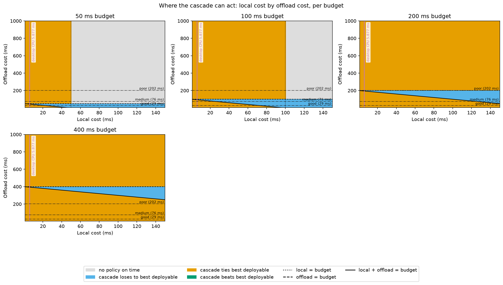

# Birds findings — why CUB-200 replaced Oxford 102 Flowers

The small/large classification pair (MobileNetV3-Large / ConvNeXt-Base) was
first built on Oxford 102 Flowers. A pilot compared it against CUB-200-2011
birds to see which dataset leaves more for an adaptive router to gain. That is
why the project moved to birds.

This file has two kinds of numbers, and they differ in how reproducible they
are:

- **Flowers and the pilot's birds figures** are copied from the pilot's output.
  That output lived in the gitignored `training/scratch/`, which has since been
  cleared. The flowers half cannot be regenerated at all (its dataset and
  checkpoints were deleted). The pilot's birds checkpoints are not the ones
  committed today, so the pilot's birds figures cannot be regenerated either.
- **The committed-checkpoint birds tables** (the **Birds, committed
  checkpoints** section below) are reproducible.
  They come from the committed birds checkpoints and from committed code that
  reproduces them. Per-photo predictions are recorded in the `bird_predictions`
  table, and the tables are computed from those records.

## Regenerating the committed-checkpoint tables

Requires migration `0004` applied (the user runs migrations). Then, from
`training/`:

```
python -m birds.evaluation.predictions   # record per-photo predictions
python -m birds.evaluation.summary       # print the tables below
```

The records hold 23,576 rows in `bird_predictions`: 11,788 photos per model
(5,400 train / 594 val / 5,794 test), each row carrying its checkpoint's
training run id. The tables below use the **test split only**. The test
accuracies derived from the records match what
`python -m birds.evaluation.evaluate` reports independently (0.7798 small,
0.8699 large), which is the cross-check that the records are right. Two
consecutive summary runs produced byte-identical output.

## Pilot settings

- Single run, no repeats, so treat differences as indicative rather than exact.
- Flowers: the committed flowers checkpoints, evaluated on the test split
  (6,149 photos).
- Birds: the same two models fine-tuned on CUB-200-2011 with the flowers
  recipe unchanged (small: 30 epochs, lr 1e-3, batch 64; large: 15 epochs,
  lr 1e-4, batch 32; AdamW, cosine schedule, label smoothing 0.1, bf16
  autocast).
- 224 px images for both datasets.
- Birds validation is a stratified 10% of the official train split (seed 42:
  5,400 fit / 594 val); the test set is the official 5,794 photos.
- Pilot validation bests on birds: small 0.8047 (epoch 26), large 0.8855
  (epoch 9).
- The flowers dataset and checkpoints were later deleted, so the flowers
  numbers cannot be re-run without re-downloading and re-training.

## Flowers vs. birds (pilot figures, not reproducible)

The decision to replace flowers was made on these numbers. The birds column
comes from the pilot's checkpoints (small 0.7727 / large 0.8676), not from the
committed checkpoints in the next section.

| | Flowers-102 (n=6,149) | CUB-200 birds, pilot (n=5,794) |
|---|---|---|
| Small accuracy | 0.9221 | 0.7727 |
| Large accuracy | 0.9467 | 0.8676 |
| Gap (large - small) | +0.0246 | +0.0949 |
| Both right | 0.9031 | 0.7421 |
| Only large right | 0.0436 | 0.1255 |
| Only small right | 0.0190 | 0.0305 |
| Both wrong | 0.0343 | 0.1018 |
| Oracle (whichever is right) | 0.9657 | 0.8982 |
| Confidence AUC, max probability | 0.926 | 0.844 |
| Confidence AUC, top-2 margin | 0.933 | 0.854 |

Confidence AUC is how well the small model's confidence separates its correct
predictions from its wrong ones.

Pilot cascade, escalating the small model's least-confident predictions (by
max softmax probability) to the large model. "Gap recovered" is the share of
the small-to-large accuracy gap regained.

| Escalated | Flowers accuracy | Flowers gap recovered | Birds accuracy | Birds gap recovered |
|---|---|---|---|---|
| 0% | 0.9221 | 0.0% | 0.7727 | 0.0% |
| 5% | 0.9312 | 37.1% | 0.7941 | 22.5% |
| 10% | 0.9393 | 70.2% | 0.8119 | 41.3% |
| 15% | 0.9447 | 92.1% | 0.8241 | 54.2% |
| 20% | 0.9462 | 98.0% | 0.8369 | 67.6% |
| 30% | 0.9475 | 103.3% | 0.8517 | 83.3% |
| 50% | 0.9465 | 99.3% | 0.8657 | 98.0% |
| 100% | 0.9467 | 100.0% | 0.8676 | 100.0% |

Label smoothing 0.1 compresses the small model's probabilities, so read the
confidence ordering rather than the absolute confidence values.

## Birds, committed checkpoints (reproducible)

Test split, 5,794 photos. Regenerate with the two commands above.

The recipe of record is `TRAIN_SETTINGS` in `training/birds/config.py`: small
30 epochs at lr 1e-3, batch 64; large 15 epochs at lr 1e-4, batch 32. Those
values match the pilot settings listed above, but nothing in this file
re-verifies that the committed checkpoints were trained under them — the claim
rests on the config being unchanged since they were trained, not on a
measurement. Each stored prediction does carry its checkpoint's training run
id, so a run's settings can be checked against the tracking store if it
matters.

### Small vs. large

| | CUB-200 birds (n=5,794) |
|---|---|
| Small accuracy | 0.7798 |
| Large accuracy | 0.8699 |
| Gap (large - small) | 0.0901 |
| Both right | 0.7497 |
| Only large right | 0.1201 |
| Only small right | 0.0300 |
| Both wrong | 0.1001 |
| Oracle (whichever is right) | 0.8999 |

Confidence AUC (correct vs. incorrect predictions):

| Model | Max probability | Top-2 margin |
|---|---|---|
| Small | 0.8324 | 0.8443 |
| Large | 0.8816 | 0.8864 |

The large model's own AUCs are new; the pilot only computed the small model's.

### Cascade

Escalated counts are floor (`n * percent // 100`), which is why 5% is 289
photos of 5,794 rather than 290.

| Escalated | Photos | Max-probability accuracy | Gap recovered | Top-2-margin accuracy | Gap recovered |
|---|---|---|---|---|---|
| 0% | 0 | 0.7798 | 0.0000 | 0.7798 | 0.0000 |
| 5% | 289 | 0.7979 | 0.2011 | 0.7981 | 0.2031 |
| 10% | 579 | 0.8122 | 0.3602 | 0.8148 | 0.3889 |
| 15% | 869 | 0.8260 | 0.5134 | 0.8293 | 0.5498 |
| 20% | 1158 | 0.8359 | 0.6226 | 0.8416 | 0.6858 |
| 30% | 1738 | 0.8523 | 0.8046 | 0.8562 | 0.8487 |
| 50% | 2897 | 0.8654 | 0.9502 | 0.8668 | 0.9655 |
| 100% | 5794 | 0.8699 | 1.0000 | 0.8699 | 1.0000 |

Top-2 margin beats max probability at every escalation level (for example
0.3889 vs. 0.3602 of the gap recovered at 10%, 0.8487 vs. 0.8046 at 30%).

## Interpretation

On the pilot figures, flowers' small-to-large gap is only 2.46 points and
about 15% escalation recovers most of it, so there is little for a router to
decide. Birds had a gap of 9.49 points and needed far more escalation to
recover it, leaving a larger prize, while confidence remained informative
(AUC 0.844 to 0.854).

The committed checkpoints tell the same story for birds: a gap of 9.01
points, with 50% escalation needed to recover 0.9502 of it (by max
probability), and confidence still informative on both models. The
flowers-vs-birds comparison itself rests on the pilot's numbers only; no
flowers figure was recomputed for this feature.

## Birds cascade under a hard latency budget

The cascade above is reported against the *share* escalated, with no cost on
escalating. This section charges for it. A cascade runs the small model first
and the large one second, so under a deadline it pays local cost plus offload
cost. The question is where, if anywhere, that beats running one model, and how
the answer moves as the budget tightens.

The hard-budget framing (latency is a constraint, not a penalty term) follows
DeepDecision (Ran et al., INFOCOM 2018). The escalate-on-low-confidence
framing follows Big/LITTLE (Park et al., CODES+ISSS 2015) and DDNN
(Teerapittayanon et al., ICDCS 2017). Attempt 1 applied the same framing to
COCO; this is the birds counterpart.

### Result

**The cascade is never useful here, in any of the 36 reported cells.** Its
on-time accuracy ties the best deployable policy wherever it can act at all, and
loses outright in the two cells where offload fits the budget but escalation
does not. The boundary figure has no region where it beats the best deployable
policy. This is a characterised negative result, and the two halves of it are
different in kind:

- The *latency* half is a theorem. Escalation costs local plus offload, which
  always exceeds offload alone, so a hard budget can never make the cascade the
  only option that fits (see the bands below).
- The *accuracy* half is empirical. Where escalation is affordable the cascade
  reaches 0.8700 on-time accuracy against always-offload's 0.8699, a
  difference the 95% bootstrap interval cannot separate from zero
  ([-0.0007, +0.0010]). It gets there only by escalating 83.24% of photos
  (max probability) or 82.29% (top-2 margin).

### Regenerating this section

Requires migration `0004` applied and the MLflow backend reachable. From
`training/`:

```
python -m birds.evaluation.predictions                                  # record per-photo predictions
python -m birds.evaluation.evaluate                                     # measured per-photo latency
python -m birds.router.budget_experiment --server-compute-ms 6.731      # this section
```

The experiment reads the stored predictions and runs no inference. It prints the
tables and verdicts below, records one MLflow run, and writes the figure to
`training/birds/router/latency_budget_boundary.png`. Defaults used: budgets
50, 100, 200 and 400 ms; payload 11.39 KB; local cost swept 1 to 150 ms and
offload cost 5 to 1000 ms in the figure. Every number below came from this run's
output.

The run is deterministic, as the spec requires: two runs over unchanged records
produced byte-identical reports, verified by diffing their output.

Existing entry points, re-checked on the same day: `evaluate` reproduces test
accuracy 0.7798 (small) and 0.8699 (large); `predictions` re-recorded
5,400 train, 594 val and 5,794 test rows for each model (it replaces rows per
model and split) and exited cleanly; `summary` output before and after
re-recording was identical apart from the log timestamp, and matches the Small
vs. large and Cascade tables above.

### What is being swept

Latency is a swept parameter, not read per photo; no per-photo latency exists
for birds. Every cell fixes a local cost, an offload cost and a budget, so every
photo in a cell shares the same latencies. **Structural consequence:** the two
static baselines are all-on-time or all-late within a cell (their over-budget
share is 0% or 100% in every row below), and the cascade is the only policy whose
decision varies photo to photo. This differs from attempt 1, where latency
varied per request.

**Offload cost** is server compute + payload transfer + round trip, with a fixed
11.39 KB payload (one photo encoded at the 224 px input resolution):

| Network | Bandwidth | Round trip | Transfer | Server compute | Offload cost |
|---|---|---|---|---|---|
| good | 50 Mbps | 20 ms | 1.82 ms | 6.731 ms | 28.6 ms |
| medium | 10 Mbps | 60 ms | 9.11 ms | 6.731 ms | 75.8 ms |
| poor | 2 Mbps | 150 ms | 45.56 ms | 6.731 ms | 202.3 ms |

Server compute, 6.731 ms, is the large model's measured per-photo latency on
the desktop GPU, from `python -m birds.evaluation.evaluate`. A desktop RTX 5070
stands in for a server GPU. The same run measured the small model at 5.586 ms
per photo on the desktop CPU (6 threads). Server compute is therefore about the
same as local cost and far below the transfer and round-trip terms: offload
cost is dominated by the network, not the server. That is why the bands below
are set almost entirely by which network the phone is on.

**Local cost** is swept, with three marked values per budget: 5.877 ms (the
small model's recorded desktop CPU time), 20 ms and 50 ms.

### The local axis is unanchored on real hardware

No on-device birds measurement exists. The one real local figure, the small
model's desktop CPU time, is a desktop number, not a phone number, and it moves
under repeat measurement: the recorded reference is 5.877 ms (September run,
`SMALL_DESKTOP_CPU_MS`), and re-measuring on the same machine with the same code
today gave 5.586 ms, a difference of about 5%. The axis is a sweep, not a
calibration, and even its one real mark is soft. The reference constant was left
at 5.877 ms deliberately, as a mark on a swept axis.

Attempt 1's phone figures measure YOLOv8n on COCO frames, not any birds model,
and are not used as anchors anywhere here.

What would anchor it: a Core ML (iOS) or TFLite build of the small model
(MobileNetV3-Large) timed on a real phone. Because the cascade keys on
confidence, that build's *predictions and confidences* on the same split must
be recorded too, not just its speed (see the first caveat below).

### Boundary figure



One panel per budget (50, 100, 200, 400 ms) over the local-cost by
offload-cost plane. The fill compares the cascade with the *best deployable
policy* (always-local, always-offload or budget-only; the oracle is excluded
because it is not deployable), with a tie tolerance of 0.001 on-time accuracy
(about 6 photos): grey means no policy is on time, blue means the cascade loses,
orange means it ties, green means it beats. Horizontal dash-dot lines mark the
three named networks (good 29, medium 76, poor 202 ms offload), and a vertical
mark sits at the small model's 5.877 ms desktop CPU time.

What it shows:

- **Green never appears.** There is no cell, at any budget, where the cascade
  beats the best deployable policy.
- **Blue is a single wedge**, between the dashed line (offload = budget) and the
  solid diagonal (local + offload = budget). That is the offload-but-no-escalation
  band: offload fits, escalation does not, so the cascade is stuck local while
  budget-only and always-offload run the large model.
- **Grey** fills the region where local cost exceeds the budget (dotted vertical
  line): at 50 ms it starts at 50 ms local cost, at 100 ms at 100 ms. At 200
  and 400 ms the swept range (to 150 ms) never reaches it.
- **Orange fills the rest**: below the diagonal everything is on time and all
  policies reach their plain accuracies, which the cascade matches; above the
  dashed line offload does not fit, so the cascade and budget-only both run
  locally.
- The vertical mark for the desktop small model is drawn in pink at 5.877 ms,
  labelled against a white background so it stays legible over the fill.

### Where the boundary sits, and how it moves with the budget

The boundary is the wedge between offload = budget and local + offload = budget.
As the budget tightens the wedge slides down the offload axis and stays exactly
`local` wide:

- **400 ms:** the wedge sits at offload costs of 400 minus local up to 400. It
  does not touch any named network at the marked local costs. All nine marked
  cells at this budget are in the everything band, including the poor network
  (202.3 ms offload plus 5.877 to 50 ms local stays under 400).
- **200 ms:** the wedge covers offload costs of 200 minus local up to 200. The
  poor network (202.3 ms) lies just above it and is local-only. Good and medium
  are in the everything band at all three marked local costs.
- **100 ms:** the wedge reaches the medium network once local cost passes
  about 24 ms (75.8 + local > 100). At the marked 50 ms local cost, medium falls in
  the wedge. Poor is local only.
- **50 ms:** only the good network can offload at all. Good is in the wedge at
  50 ms local cost (28.6 + 50 > 50) and in the everything band at 5.877 and 20.
  Medium and poor are local only.

Budget tightening therefore moves cells out of the everything band, first into
the wedge and then into local-only, and the wedge is the only place the cascade
loses. It never moves a cell into a region where the cascade wins.

### The four bands

In a cell with local cost L, offload cost O and budget B, exactly one of four
bands holds:

| Band | Condition | Consequence |
|---|---|---|
| Nothing fits | L > B | Every policy has 0 on-time accuracy, for any threshold |
| Local only | L ≤ B and O > B | Offload never fits; cascade is always-local |
| Offload but no escalation | O ≤ B < L + O | Offload fits, escalation never does; cascade is always-local |
| Everything | L + O ≤ B | Everything is on time; on-time accuracy equals plain accuracy |

**The escalation band always sits above the offload band.** Escalation fits when
L + O ≤ B, offload fits when O ≤ B, and L + O ≥ O for non-negative costs, so
escalation fitting implies offload fitting and never the reverse. A hard budget
therefore never makes the cascade the only option that fits. The cascade's case
has to be made on accuracy and on offload calls avoided, not on fitting a
deadline nothing else fits.

**The width of the band where offload fits but escalation does not is L**
(budgets B with O ≤ B < L + O, an interval of length L), so cheaper local
inference widens the range of budgets in which the cascade can act at all.
The band summary in the output prints this as "lockout" (5.877 ms, 20 ms
and 50 ms for the three marked local costs).

**The result is exact, not approximate, which is why the table below is so
repetitive.** Inside a band, nothing depends on L, O or B: in "nothing fits"
every policy scores 0; in "local only" and the offload-no-escalation band the
cascade *is* always-local for any threshold; in "everything" on-time accuracy is
plain accuracy, which depends on the threshold alone. So the cascade's standing
against the other policies depends only on which band a cell is in, never on the
latency values inside the band.

Bands across the 36 reported cells (4 budgets x 3 networks x 3 local costs):

| Band | Cells |
|---|---|
| Everything | 22 |
| Offload but no escalation | 2 (50 ms budget, good, 50 ms local; 100 ms budget, medium, 50 ms local) |
| Local only | 12 |
| Nothing fits | 0 (every marked local cost is at most the smallest budget, 50 ms) |

The reported budgets satisfy the spec's requirement: 50 ms is below the poor
network's offload cost (202.3 ms) and 400 ms admits escalation under good.

### Per-budget tables

Test split, 5,794 photos. Each cell evaluates six rows: the four policies, with
the cascade under each confidence measure, and the within-budget oracle. On-time
accuracy counts a result arriving after the budget as zero. The cascade's
threshold for each cell is tuned on the 594 validation photos and applied to the
test photos; no test photo informs it.

In every everything-band cell the tuned thresholds are 0.8728 (max probability)
and 0.8537 (top-2 margin), escalating 83.24% and 82.29% of test photos. In the
local-only and offload-no-escalation cells the tuned thresholds are 0.0418 and
0.0004 and escalate 0.00%, which is simply always-local.

Notable readings from the tables:

- The cascade's on-time accuracy is 0.8700 in every everything-band cell,
  against always-offload's and budget-only's 0.8699, and the oracle's 0.8999.
  The cascade closes none of the gap to the oracle.
- Mean latency is where escalation costs show up. At 5.877 ms local cost on the
  good network the cascade averages 29.65 ms against always-offload's 28.55 ms,
  and at 50 ms local cost 73.77 ms against 28.55 ms: it pays for both models on
  most photos. On the medium and poor networks the order flips (medium, 5.877 ms
  local: 69.01 ms against 75.84 ms; poor at 400 ms budget: 174.27 ms against
  202.29 ms), because the 16.76% of photos it does not escalate skip the slow
  offload.
- In the local-only band always-offload scores 0.0000 on-time with a 100.00%
  over-budget share, while the other policies keep the small model's 0.7798.

<details>
<summary>Full per-budget tables (216 rows)</summary>

#### 50 ms budget

| Network (offload ms) | Local ms | Band | Policy | Mean acc | On-time acc | Mean latency ms | Over budget |
|---|---|---|---|---|---|---|---|
| good (28.6) | 5.877 | everything | always-local | 0.7798 | 0.7798 | 5.88 | 0.00% |
| good (28.6) | 5.877 | everything | always-offload | 0.8699 | 0.8699 | 28.55 | 0.00% |
| good (28.6) | 5.877 | everything | budget-only | 0.8699 | 0.8699 | 28.55 | 0.00% |
| good (28.6) | 5.877 | everything | cascade (max_probability) | 0.8700 | 0.8700 | 29.65 | 0.00% |
| good (28.6) | 5.877 | everything | cascade (top2_margin) | 0.8700 | 0.8700 | 29.37 | 0.00% |
| good (28.6) | 5.877 | everything | oracle | 0.8999 | 0.8999 | 8.60 | 0.00% |
| good (28.6) | 20 | everything | always-local | 0.7798 | 0.7798 | 20.00 | 0.00% |
| good (28.6) | 20 | everything | always-offload | 0.8699 | 0.8699 | 28.55 | 0.00% |
| good (28.6) | 20 | everything | budget-only | 0.8699 | 0.8699 | 28.55 | 0.00% |
| good (28.6) | 20 | everything | cascade (max_probability) | 0.8700 | 0.8700 | 43.77 | 0.00% |
| good (28.6) | 20 | everything | cascade (top2_margin) | 0.8700 | 0.8700 | 43.50 | 0.00% |
| good (28.6) | 20 | everything | oracle | 0.8999 | 0.8999 | 21.03 | 0.00% |
| good (28.6) | 50 | offload but no escalation | always-local | 0.7798 | 0.7798 | 50.00 | 0.00% |
| good (28.6) | 50 | offload but no escalation | always-offload | 0.8699 | 0.8699 | 28.55 | 0.00% |
| good (28.6) | 50 | offload but no escalation | budget-only | 0.8699 | 0.8699 | 28.55 | 0.00% |
| good (28.6) | 50 | offload but no escalation | cascade (max_probability) | 0.7798 | 0.7798 | 50.00 | 0.00% |
| good (28.6) | 50 | offload but no escalation | cascade (top2_margin) | 0.7798 | 0.7798 | 50.00 | 0.00% |
| good (28.6) | 50 | offload but no escalation | oracle | 0.8999 | 0.8999 | 29.20 | 0.00% |
| medium (75.8) | 5.877 | local only | always-local | 0.7798 | 0.7798 | 5.88 | 0.00% |
| medium (75.8) | 5.877 | local only | always-offload | 0.8699 | 0.0000 | 75.84 | 100.00% |
| medium (75.8) | 5.877 | local only | budget-only | 0.7798 | 0.7798 | 5.88 | 0.00% |
| medium (75.8) | 5.877 | local only | cascade (max_probability) | 0.7798 | 0.7798 | 5.88 | 0.00% |
| medium (75.8) | 5.877 | local only | cascade (top2_margin) | 0.7798 | 0.7798 | 5.88 | 0.00% |
| medium (75.8) | 5.877 | local only | oracle | 0.7798 | 0.7798 | 5.88 | 0.00% |
| medium (75.8) | 20 | local only | always-local | 0.7798 | 0.7798 | 20.00 | 0.00% |
| medium (75.8) | 20 | local only | always-offload | 0.8699 | 0.0000 | 75.84 | 100.00% |
| medium (75.8) | 20 | local only | budget-only | 0.7798 | 0.7798 | 20.00 | 0.00% |
| medium (75.8) | 20 | local only | cascade (max_probability) | 0.7798 | 0.7798 | 20.00 | 0.00% |
| medium (75.8) | 20 | local only | cascade (top2_margin) | 0.7798 | 0.7798 | 20.00 | 0.00% |
| medium (75.8) | 20 | local only | oracle | 0.7798 | 0.7798 | 20.00 | 0.00% |
| medium (75.8) | 50 | local only | always-local | 0.7798 | 0.7798 | 50.00 | 0.00% |
| medium (75.8) | 50 | local only | always-offload | 0.8699 | 0.0000 | 75.84 | 100.00% |
| medium (75.8) | 50 | local only | budget-only | 0.7798 | 0.7798 | 50.00 | 0.00% |
| medium (75.8) | 50 | local only | cascade (max_probability) | 0.7798 | 0.7798 | 50.00 | 0.00% |
| medium (75.8) | 50 | local only | cascade (top2_margin) | 0.7798 | 0.7798 | 50.00 | 0.00% |
| medium (75.8) | 50 | local only | oracle | 0.7798 | 0.7798 | 50.00 | 0.00% |
| poor (202.3) | 5.877 | local only | always-local | 0.7798 | 0.7798 | 5.88 | 0.00% |
| poor (202.3) | 5.877 | local only | always-offload | 0.8699 | 0.0000 | 202.29 | 100.00% |
| poor (202.3) | 5.877 | local only | budget-only | 0.7798 | 0.7798 | 5.88 | 0.00% |
| poor (202.3) | 5.877 | local only | cascade (max_probability) | 0.7798 | 0.7798 | 5.88 | 0.00% |
| poor (202.3) | 5.877 | local only | cascade (top2_margin) | 0.7798 | 0.7798 | 5.88 | 0.00% |
| poor (202.3) | 5.877 | local only | oracle | 0.7798 | 0.7798 | 5.88 | 0.00% |
| poor (202.3) | 20 | local only | always-local | 0.7798 | 0.7798 | 20.00 | 0.00% |
| poor (202.3) | 20 | local only | always-offload | 0.8699 | 0.0000 | 202.29 | 100.00% |
| poor (202.3) | 20 | local only | budget-only | 0.7798 | 0.7798 | 20.00 | 0.00% |
| poor (202.3) | 20 | local only | cascade (max_probability) | 0.7798 | 0.7798 | 20.00 | 0.00% |
| poor (202.3) | 20 | local only | cascade (top2_margin) | 0.7798 | 0.7798 | 20.00 | 0.00% |
| poor (202.3) | 20 | local only | oracle | 0.7798 | 0.7798 | 20.00 | 0.00% |
| poor (202.3) | 50 | local only | always-local | 0.7798 | 0.7798 | 50.00 | 0.00% |
| poor (202.3) | 50 | local only | always-offload | 0.8699 | 0.0000 | 202.29 | 100.00% |
| poor (202.3) | 50 | local only | budget-only | 0.7798 | 0.7798 | 50.00 | 0.00% |
| poor (202.3) | 50 | local only | cascade (max_probability) | 0.7798 | 0.7798 | 50.00 | 0.00% |
| poor (202.3) | 50 | local only | cascade (top2_margin) | 0.7798 | 0.7798 | 50.00 | 0.00% |
| poor (202.3) | 50 | local only | oracle | 0.7798 | 0.7798 | 50.00 | 0.00% |

#### 100 ms budget

| Network (offload ms) | Local ms | Band | Policy | Mean acc | On-time acc | Mean latency ms | Over budget |
|---|---|---|---|---|---|---|---|
| good (28.6) | 5.877 | everything | always-local | 0.7798 | 0.7798 | 5.88 | 0.00% |
| good (28.6) | 5.877 | everything | always-offload | 0.8699 | 0.8699 | 28.55 | 0.00% |
| good (28.6) | 5.877 | everything | budget-only | 0.8699 | 0.8699 | 28.55 | 0.00% |
| good (28.6) | 5.877 | everything | cascade (max_probability) | 0.8700 | 0.8700 | 29.65 | 0.00% |
| good (28.6) | 5.877 | everything | cascade (top2_margin) | 0.8700 | 0.8700 | 29.37 | 0.00% |
| good (28.6) | 5.877 | everything | oracle | 0.8999 | 0.8999 | 8.60 | 0.00% |
| good (28.6) | 20 | everything | always-local | 0.7798 | 0.7798 | 20.00 | 0.00% |
| good (28.6) | 20 | everything | always-offload | 0.8699 | 0.8699 | 28.55 | 0.00% |
| good (28.6) | 20 | everything | budget-only | 0.8699 | 0.8699 | 28.55 | 0.00% |
| good (28.6) | 20 | everything | cascade (max_probability) | 0.8700 | 0.8700 | 43.77 | 0.00% |
| good (28.6) | 20 | everything | cascade (top2_margin) | 0.8700 | 0.8700 | 43.50 | 0.00% |
| good (28.6) | 20 | everything | oracle | 0.8999 | 0.8999 | 21.03 | 0.00% |
| good (28.6) | 50 | everything | always-local | 0.7798 | 0.7798 | 50.00 | 0.00% |
| good (28.6) | 50 | everything | always-offload | 0.8699 | 0.8699 | 28.55 | 0.00% |
| good (28.6) | 50 | everything | budget-only | 0.8699 | 0.8699 | 28.55 | 0.00% |
| good (28.6) | 50 | everything | cascade (max_probability) | 0.8700 | 0.8700 | 73.77 | 0.00% |
| good (28.6) | 50 | everything | cascade (top2_margin) | 0.8700 | 0.8700 | 73.50 | 0.00% |
| good (28.6) | 50 | everything | oracle | 0.8999 | 0.8999 | 29.20 | 0.00% |
| medium (75.8) | 5.877 | everything | always-local | 0.7798 | 0.7798 | 5.88 | 0.00% |
| medium (75.8) | 5.877 | everything | always-offload | 0.8699 | 0.8699 | 75.84 | 0.00% |
| medium (75.8) | 5.877 | everything | budget-only | 0.8699 | 0.8699 | 75.84 | 0.00% |
| medium (75.8) | 5.877 | everything | cascade (max_probability) | 0.8700 | 0.8700 | 69.01 | 0.00% |
| medium (75.8) | 5.877 | everything | cascade (top2_margin) | 0.8700 | 0.8700 | 68.29 | 0.00% |
| medium (75.8) | 5.877 | everything | oracle | 0.8999 | 0.8999 | 14.28 | 0.00% |
| medium (75.8) | 20 | everything | always-local | 0.7798 | 0.7798 | 20.00 | 0.00% |
| medium (75.8) | 20 | everything | always-offload | 0.8699 | 0.8699 | 75.84 | 0.00% |
| medium (75.8) | 20 | everything | budget-only | 0.8699 | 0.8699 | 75.84 | 0.00% |
| medium (75.8) | 20 | everything | cascade (max_probability) | 0.8700 | 0.8700 | 83.13 | 0.00% |
| medium (75.8) | 20 | everything | cascade (top2_margin) | 0.8700 | 0.8700 | 82.41 | 0.00% |
| medium (75.8) | 20 | everything | oracle | 0.8999 | 0.8999 | 26.71 | 0.00% |
| medium (75.8) | 50 | offload but no escalation | always-local | 0.7798 | 0.7798 | 50.00 | 0.00% |
| medium (75.8) | 50 | offload but no escalation | always-offload | 0.8699 | 0.8699 | 75.84 | 0.00% |
| medium (75.8) | 50 | offload but no escalation | budget-only | 0.8699 | 0.8699 | 75.84 | 0.00% |
| medium (75.8) | 50 | offload but no escalation | cascade (max_probability) | 0.7798 | 0.7798 | 50.00 | 0.00% |
| medium (75.8) | 50 | offload but no escalation | cascade (top2_margin) | 0.7798 | 0.7798 | 50.00 | 0.00% |
| medium (75.8) | 50 | offload but no escalation | oracle | 0.8999 | 0.8999 | 53.10 | 0.00% |
| poor (202.3) | 5.877 | local only | always-local | 0.7798 | 0.7798 | 5.88 | 0.00% |
| poor (202.3) | 5.877 | local only | always-offload | 0.8699 | 0.0000 | 202.29 | 100.00% |
| poor (202.3) | 5.877 | local only | budget-only | 0.7798 | 0.7798 | 5.88 | 0.00% |
| poor (202.3) | 5.877 | local only | cascade (max_probability) | 0.7798 | 0.7798 | 5.88 | 0.00% |
| poor (202.3) | 5.877 | local only | cascade (top2_margin) | 0.7798 | 0.7798 | 5.88 | 0.00% |
| poor (202.3) | 5.877 | local only | oracle | 0.7798 | 0.7798 | 5.88 | 0.00% |
| poor (202.3) | 20 | local only | always-local | 0.7798 | 0.7798 | 20.00 | 0.00% |
| poor (202.3) | 20 | local only | always-offload | 0.8699 | 0.0000 | 202.29 | 100.00% |
| poor (202.3) | 20 | local only | budget-only | 0.7798 | 0.7798 | 20.00 | 0.00% |
| poor (202.3) | 20 | local only | cascade (max_probability) | 0.7798 | 0.7798 | 20.00 | 0.00% |
| poor (202.3) | 20 | local only | cascade (top2_margin) | 0.7798 | 0.7798 | 20.00 | 0.00% |
| poor (202.3) | 20 | local only | oracle | 0.7798 | 0.7798 | 20.00 | 0.00% |
| poor (202.3) | 50 | local only | always-local | 0.7798 | 0.7798 | 50.00 | 0.00% |
| poor (202.3) | 50 | local only | always-offload | 0.8699 | 0.0000 | 202.29 | 100.00% |
| poor (202.3) | 50 | local only | budget-only | 0.7798 | 0.7798 | 50.00 | 0.00% |
| poor (202.3) | 50 | local only | cascade (max_probability) | 0.7798 | 0.7798 | 50.00 | 0.00% |
| poor (202.3) | 50 | local only | cascade (top2_margin) | 0.7798 | 0.7798 | 50.00 | 0.00% |
| poor (202.3) | 50 | local only | oracle | 0.7798 | 0.7798 | 50.00 | 0.00% |

#### 200 ms budget

| Network (offload ms) | Local ms | Band | Policy | Mean acc | On-time acc | Mean latency ms | Over budget |
|---|---|---|---|---|---|---|---|
| good (28.6) | 5.877 | everything | always-local | 0.7798 | 0.7798 | 5.88 | 0.00% |
| good (28.6) | 5.877 | everything | always-offload | 0.8699 | 0.8699 | 28.55 | 0.00% |
| good (28.6) | 5.877 | everything | budget-only | 0.8699 | 0.8699 | 28.55 | 0.00% |
| good (28.6) | 5.877 | everything | cascade (max_probability) | 0.8700 | 0.8700 | 29.65 | 0.00% |
| good (28.6) | 5.877 | everything | cascade (top2_margin) | 0.8700 | 0.8700 | 29.37 | 0.00% |
| good (28.6) | 5.877 | everything | oracle | 0.8999 | 0.8999 | 8.60 | 0.00% |
| good (28.6) | 20 | everything | always-local | 0.7798 | 0.7798 | 20.00 | 0.00% |
| good (28.6) | 20 | everything | always-offload | 0.8699 | 0.8699 | 28.55 | 0.00% |
| good (28.6) | 20 | everything | budget-only | 0.8699 | 0.8699 | 28.55 | 0.00% |
| good (28.6) | 20 | everything | cascade (max_probability) | 0.8700 | 0.8700 | 43.77 | 0.00% |
| good (28.6) | 20 | everything | cascade (top2_margin) | 0.8700 | 0.8700 | 43.50 | 0.00% |
| good (28.6) | 20 | everything | oracle | 0.8999 | 0.8999 | 21.03 | 0.00% |
| good (28.6) | 50 | everything | always-local | 0.7798 | 0.7798 | 50.00 | 0.00% |
| good (28.6) | 50 | everything | always-offload | 0.8699 | 0.8699 | 28.55 | 0.00% |
| good (28.6) | 50 | everything | budget-only | 0.8699 | 0.8699 | 28.55 | 0.00% |
| good (28.6) | 50 | everything | cascade (max_probability) | 0.8700 | 0.8700 | 73.77 | 0.00% |
| good (28.6) | 50 | everything | cascade (top2_margin) | 0.8700 | 0.8700 | 73.50 | 0.00% |
| good (28.6) | 50 | everything | oracle | 0.8999 | 0.8999 | 29.20 | 0.00% |
| medium (75.8) | 5.877 | everything | always-local | 0.7798 | 0.7798 | 5.88 | 0.00% |
| medium (75.8) | 5.877 | everything | always-offload | 0.8699 | 0.8699 | 75.84 | 0.00% |
| medium (75.8) | 5.877 | everything | budget-only | 0.8699 | 0.8699 | 75.84 | 0.00% |
| medium (75.8) | 5.877 | everything | cascade (max_probability) | 0.8700 | 0.8700 | 69.01 | 0.00% |
| medium (75.8) | 5.877 | everything | cascade (top2_margin) | 0.8700 | 0.8700 | 68.29 | 0.00% |
| medium (75.8) | 5.877 | everything | oracle | 0.8999 | 0.8999 | 14.28 | 0.00% |
| medium (75.8) | 20 | everything | always-local | 0.7798 | 0.7798 | 20.00 | 0.00% |
| medium (75.8) | 20 | everything | always-offload | 0.8699 | 0.8699 | 75.84 | 0.00% |
| medium (75.8) | 20 | everything | budget-only | 0.8699 | 0.8699 | 75.84 | 0.00% |
| medium (75.8) | 20 | everything | cascade (max_probability) | 0.8700 | 0.8700 | 83.13 | 0.00% |
| medium (75.8) | 20 | everything | cascade (top2_margin) | 0.8700 | 0.8700 | 82.41 | 0.00% |
| medium (75.8) | 20 | everything | oracle | 0.8999 | 0.8999 | 26.71 | 0.00% |
| medium (75.8) | 50 | everything | always-local | 0.7798 | 0.7798 | 50.00 | 0.00% |
| medium (75.8) | 50 | everything | always-offload | 0.8699 | 0.8699 | 75.84 | 0.00% |
| medium (75.8) | 50 | everything | budget-only | 0.8699 | 0.8699 | 75.84 | 0.00% |
| medium (75.8) | 50 | everything | cascade (max_probability) | 0.8700 | 0.8700 | 113.13 | 0.00% |
| medium (75.8) | 50 | everything | cascade (top2_margin) | 0.8700 | 0.8700 | 112.41 | 0.00% |
| medium (75.8) | 50 | everything | oracle | 0.8999 | 0.8999 | 53.10 | 0.00% |
| poor (202.3) | 5.877 | local only | always-local | 0.7798 | 0.7798 | 5.88 | 0.00% |
| poor (202.3) | 5.877 | local only | always-offload | 0.8699 | 0.0000 | 202.29 | 100.00% |
| poor (202.3) | 5.877 | local only | budget-only | 0.7798 | 0.7798 | 5.88 | 0.00% |
| poor (202.3) | 5.877 | local only | cascade (max_probability) | 0.7798 | 0.7798 | 5.88 | 0.00% |
| poor (202.3) | 5.877 | local only | cascade (top2_margin) | 0.7798 | 0.7798 | 5.88 | 0.00% |
| poor (202.3) | 5.877 | local only | oracle | 0.7798 | 0.7798 | 5.88 | 0.00% |
| poor (202.3) | 20 | local only | always-local | 0.7798 | 0.7798 | 20.00 | 0.00% |
| poor (202.3) | 20 | local only | always-offload | 0.8699 | 0.0000 | 202.29 | 100.00% |
| poor (202.3) | 20 | local only | budget-only | 0.7798 | 0.7798 | 20.00 | 0.00% |
| poor (202.3) | 20 | local only | cascade (max_probability) | 0.7798 | 0.7798 | 20.00 | 0.00% |
| poor (202.3) | 20 | local only | cascade (top2_margin) | 0.7798 | 0.7798 | 20.00 | 0.00% |
| poor (202.3) | 20 | local only | oracle | 0.7798 | 0.7798 | 20.00 | 0.00% |
| poor (202.3) | 50 | local only | always-local | 0.7798 | 0.7798 | 50.00 | 0.00% |
| poor (202.3) | 50 | local only | always-offload | 0.8699 | 0.0000 | 202.29 | 100.00% |
| poor (202.3) | 50 | local only | budget-only | 0.7798 | 0.7798 | 50.00 | 0.00% |
| poor (202.3) | 50 | local only | cascade (max_probability) | 0.7798 | 0.7798 | 50.00 | 0.00% |
| poor (202.3) | 50 | local only | cascade (top2_margin) | 0.7798 | 0.7798 | 50.00 | 0.00% |
| poor (202.3) | 50 | local only | oracle | 0.7798 | 0.7798 | 50.00 | 0.00% |

#### 400 ms budget

| Network (offload ms) | Local ms | Band | Policy | Mean acc | On-time acc | Mean latency ms | Over budget |
|---|---|---|---|---|---|---|---|
| good (28.6) | 5.877 | everything | always-local | 0.7798 | 0.7798 | 5.88 | 0.00% |
| good (28.6) | 5.877 | everything | always-offload | 0.8699 | 0.8699 | 28.55 | 0.00% |
| good (28.6) | 5.877 | everything | budget-only | 0.8699 | 0.8699 | 28.55 | 0.00% |
| good (28.6) | 5.877 | everything | cascade (max_probability) | 0.8700 | 0.8700 | 29.65 | 0.00% |
| good (28.6) | 5.877 | everything | cascade (top2_margin) | 0.8700 | 0.8700 | 29.37 | 0.00% |
| good (28.6) | 5.877 | everything | oracle | 0.8999 | 0.8999 | 8.60 | 0.00% |
| good (28.6) | 20 | everything | always-local | 0.7798 | 0.7798 | 20.00 | 0.00% |
| good (28.6) | 20 | everything | always-offload | 0.8699 | 0.8699 | 28.55 | 0.00% |
| good (28.6) | 20 | everything | budget-only | 0.8699 | 0.8699 | 28.55 | 0.00% |
| good (28.6) | 20 | everything | cascade (max_probability) | 0.8700 | 0.8700 | 43.77 | 0.00% |
| good (28.6) | 20 | everything | cascade (top2_margin) | 0.8700 | 0.8700 | 43.50 | 0.00% |
| good (28.6) | 20 | everything | oracle | 0.8999 | 0.8999 | 21.03 | 0.00% |
| good (28.6) | 50 | everything | always-local | 0.7798 | 0.7798 | 50.00 | 0.00% |
| good (28.6) | 50 | everything | always-offload | 0.8699 | 0.8699 | 28.55 | 0.00% |
| good (28.6) | 50 | everything | budget-only | 0.8699 | 0.8699 | 28.55 | 0.00% |
| good (28.6) | 50 | everything | cascade (max_probability) | 0.8700 | 0.8700 | 73.77 | 0.00% |
| good (28.6) | 50 | everything | cascade (top2_margin) | 0.8700 | 0.8700 | 73.50 | 0.00% |
| good (28.6) | 50 | everything | oracle | 0.8999 | 0.8999 | 29.20 | 0.00% |
| medium (75.8) | 5.877 | everything | always-local | 0.7798 | 0.7798 | 5.88 | 0.00% |
| medium (75.8) | 5.877 | everything | always-offload | 0.8699 | 0.8699 | 75.84 | 0.00% |
| medium (75.8) | 5.877 | everything | budget-only | 0.8699 | 0.8699 | 75.84 | 0.00% |
| medium (75.8) | 5.877 | everything | cascade (max_probability) | 0.8700 | 0.8700 | 69.01 | 0.00% |
| medium (75.8) | 5.877 | everything | cascade (top2_margin) | 0.8700 | 0.8700 | 68.29 | 0.00% |
| medium (75.8) | 5.877 | everything | oracle | 0.8999 | 0.8999 | 14.28 | 0.00% |
| medium (75.8) | 20 | everything | always-local | 0.7798 | 0.7798 | 20.00 | 0.00% |
| medium (75.8) | 20 | everything | always-offload | 0.8699 | 0.8699 | 75.84 | 0.00% |
| medium (75.8) | 20 | everything | budget-only | 0.8699 | 0.8699 | 75.84 | 0.00% |
| medium (75.8) | 20 | everything | cascade (max_probability) | 0.8700 | 0.8700 | 83.13 | 0.00% |
| medium (75.8) | 20 | everything | cascade (top2_margin) | 0.8700 | 0.8700 | 82.41 | 0.00% |
| medium (75.8) | 20 | everything | oracle | 0.8999 | 0.8999 | 26.71 | 0.00% |
| medium (75.8) | 50 | everything | always-local | 0.7798 | 0.7798 | 50.00 | 0.00% |
| medium (75.8) | 50 | everything | always-offload | 0.8699 | 0.8699 | 75.84 | 0.00% |
| medium (75.8) | 50 | everything | budget-only | 0.8699 | 0.8699 | 75.84 | 0.00% |
| medium (75.8) | 50 | everything | cascade (max_probability) | 0.8700 | 0.8700 | 113.13 | 0.00% |
| medium (75.8) | 50 | everything | cascade (top2_margin) | 0.8700 | 0.8700 | 112.41 | 0.00% |
| medium (75.8) | 50 | everything | oracle | 0.8999 | 0.8999 | 53.10 | 0.00% |
| poor (202.3) | 5.877 | everything | always-local | 0.7798 | 0.7798 | 5.88 | 0.00% |
| poor (202.3) | 5.877 | everything | always-offload | 0.8699 | 0.8699 | 202.29 | 0.00% |
| poor (202.3) | 5.877 | everything | budget-only | 0.8699 | 0.8699 | 202.29 | 0.00% |
| poor (202.3) | 5.877 | everything | cascade (max_probability) | 0.8700 | 0.8700 | 174.27 | 0.00% |
| poor (202.3) | 5.877 | everything | cascade (top2_margin) | 0.8700 | 0.8700 | 172.35 | 0.00% |
| poor (202.3) | 5.877 | everything | oracle | 0.8999 | 0.8999 | 29.47 | 0.00% |
| poor (202.3) | 20 | everything | always-local | 0.7798 | 0.7798 | 20.00 | 0.00% |
| poor (202.3) | 20 | everything | always-offload | 0.8699 | 0.8699 | 202.29 | 0.00% |
| poor (202.3) | 20 | everything | budget-only | 0.8699 | 0.8699 | 202.29 | 0.00% |
| poor (202.3) | 20 | everything | cascade (max_probability) | 0.8700 | 0.8700 | 188.39 | 0.00% |
| poor (202.3) | 20 | everything | cascade (top2_margin) | 0.8700 | 0.8700 | 186.47 | 0.00% |
| poor (202.3) | 20 | everything | oracle | 0.8999 | 0.8999 | 41.90 | 0.00% |
| poor (202.3) | 50 | everything | always-local | 0.7798 | 0.7798 | 50.00 | 0.00% |
| poor (202.3) | 50 | everything | always-offload | 0.8699 | 0.8699 | 202.29 | 0.00% |
| poor (202.3) | 50 | everything | budget-only | 0.8699 | 0.8699 | 202.29 | 0.00% |
| poor (202.3) | 50 | everything | cascade (max_probability) | 0.8700 | 0.8700 | 218.39 | 0.00% |
| poor (202.3) | 50 | everything | cascade (top2_margin) | 0.8700 | 0.8700 | 216.47 | 0.00% |
| poor (202.3) | 50 | everything | oracle | 0.8999 | 0.8999 | 68.29 | 0.00% |

</details>

### Usefulness verdicts

The cascade counts as useful in a cell only when the 95% bootstrap interval
(resampling test photos) of its on-time accuracy minus budget-only's lies
entirely above zero. Across the 72 verdicts (36 cells, two confidence measures)
**all 72 are "not useful"**. They fall in three groups, by band:

| Band | Cells | Interval vs budget-only | Verdict |
|---|---|---|---|
| Everything | 22 | [-0.0007, +0.0010] | not useful (straddles zero) |
| Local only | 12 | [+0.0000, +0.0000] | not useful (cascade is always-local, as is budget-only) |
| Offload but no escalation | 2 | [-0.0998, -0.0803] | not useful (cascade is worse) |

The interval is identical across all cells of a band, and the same for both
confidence measures, as the band argument predicts.

The interval against always-local tells the other half of the story, and it is
the more flattering half:

| Band | Cells | Interval vs always-local |
|---|---|---|
| Everything | 22 | [+0.0803, +0.0999] |
| Local only | 12 | [+0.0000, +0.0000] |
| Offload but no escalation | 2 | [+0.0000, +0.0000] |

So the cascade is not useless in absolute terms. Wherever escalation is
affordable it beats always-local decisively — the interval sits entirely above
zero and brackets the 0.0901 small-to-large accuracy gap, meaning the cascade
recovers essentially the whole of the large model's advantage. Where escalation
is unaffordable it *is* always-local, exactly, so the difference is zero by
construction rather than by measurement.

The negative result is therefore narrower than "the cascade does not work": the
cascade buys the large model's accuracy, but it pays local + offload latency to
do so, while plain always-offload buys the same accuracy for offload alone. Its
failure is one of redundancy under a hard budget, not of accuracy. Usefulness is
defined against budget-only precisely because budget-only already picks the
better of the two static policies in each cell, so it is the comparison that can
embarrass the cascade — and it does.

Two noise notes: the validation split is only 594 photos, so the tuned threshold
is noisy, and that split was already used once to select the checkpoints.

### Fewest offload calls at which the cascade matches always-offload

Wherever escalation is affordable (the 22 everything-band cells), escalating
every photo reproduces always-offload exactly, so a match always exists and the
interesting number is the share of photos at which it happens. The fewest
offload calls that reach always-offload's accuracy on the test split are:

| Confidence measure | Offload calls | Share of 5,794 |
|---|---|---|
| Max probability | 4,184 | 72.2% |
| Top-2 margin | 3,978 | 68.7% |

So matching the large model alone still sends around 7 in 10 photos to it. The
saving, about 28% to 31% of offload calls, is the cascade's whole payoff when
accuracy ties, and it comes only in cells where escalation also fits the
budget. In the 14 cells where escalation is unaffordable (local only plus
offload-but-no-escalation) the output reports `None`: it never matches
always-offload there, because it cannot escalate at all.

### Caveats

1. **The predictions are a desktop full-precision stand-in for the local path.**
   Both models' predictions were computed on a desktop GPU in full precision. A
   deployed local path would run an exported, likely reduced-precision model on
   the phone. Conversion shifts not only accuracy but the confidence values
   themselves, which is exactly what the cascade's threshold keys on. Every
   cascade figure here describes the desktop small model, not a measured
   on-device one. The exported model's predictions and confidences (not just its
   speed) must be measured before any threshold is trusted on a phone.
2. **Offload cost is exact in every cell, so the cascade's hedging advantage is
   unmeasured.** Each cell fixes one offload cost, so no policy is ever surprised
   by a slow network. A deployed router works from an estimate. The cascade has a
   property this design cannot score: having run the small model first, it already
   holds an answer, so it can return the local result when the network
   disappoints instead of missing the deadline with nothing. That advantage is
   not measured here. **The next experiment is offload cost drawn with noise**,
   scoring the policies on actual latency against an estimated one.

Smaller caveats: the run is single-pass on one test split; the tuned thresholds
come from a 594-photo validation split; and the offload costs are analytical, not
measured on a real endpoint.
